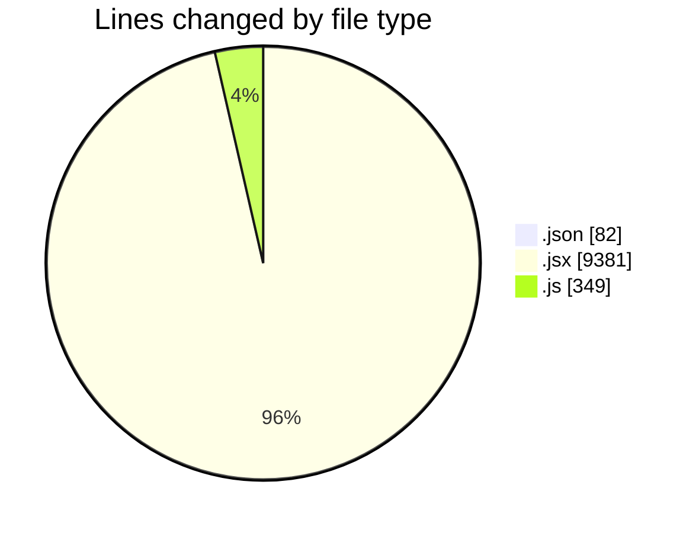
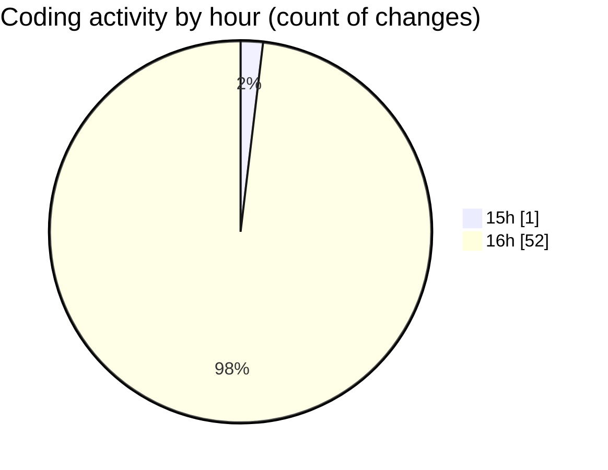

# nashik-misal-queue - Activity Summary 

## Overall Statistics

| Stat                   | Value                                                             |
| ---------------------- | ----------------------------------------------------------------- |
| **Lines Added** (➕)   | 7898                                          |
| **Lines Removed** (➖) | 1914                                        |
| **Net Change** (↕)    | 5984                |
| **Active Time** (⌚)   | 58 minutes |

## Modified Files
- **settings.json** (+82, -0)
- **CheckToken.jsx** (+459, -229)
- **ConfirmDetails.jsx** (+929, -432)
- **FinalCall.jsx** (+414, -5)
- **OwnerDashboard.jsx** (+2192, -1234)
- **HomeScreen.jsx** (+583, -10)
- **CustomerArrived.jsx** (+391, -4)
- **QueueStatus.jsx** (+514, -0)
- **App.jsx** (+113, -0)
- **main.jsx** (+6, -0)
- **advertisements.api.js** (+158, -0)
- **auth.api.js** (+24, -0)
- **axios.js** (+55, -0)
- **menu.api.js** (+32, -0)
- **shop.api.js** (+16, -0)
- **staff.api.js** (+31, -0)
- **token.api.js** (+33, -0)
- **assets.jsx** (+338, -0)
- **AdvertisementCard.jsx** (+256, -0)
- **AdvertisementCarousel.jsx** (+388, -0)
- **MisalLoader.jsx** (+28, -0)
- **SimpleLoader.jsx** (+40, -0)
- **TokenCallListener.jsx** (+83, -0)
- **LoginLeftSide.jsx** (+22, -0)
- **ProtectedRoute.jsx** (+20, -0)
- **Layout.jsx** (+19, -0)
- **AddStaffModal.jsx** (+281, -0)
- **InputField.jsx** (+42, -0)
- **Modal.jsx** (+44, -0)
- **PendingArrivalCard.jsx** (+113, -0)
- **QueueSection.jsx** (+107, -0)
- **StaffHeader.jsx** (+42, -0)
- **StaffSidebar.jsx** (+43, -0)

## Visualizations

### By File Type (Lines Changed)

### By Hour (Estimated Activity Count)

> **Last Updated:** 18/11/2026, 16:22:13